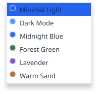
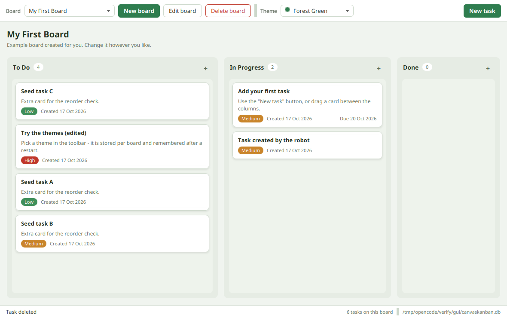

# CanvasKanban

[](https://github.com/Param-42/canvaskanban/actions/workflows/build.yml)

A small, friendly desktop Kanban board written in JavaFX, with everything stored locally
in an SQLite file. No account, no server, no internet connection: start it and start
moving cards.


## Table of contents

- [What it does](#what-it-does)
- [Themes](#themes)
- [Requirements](#requirements)
- [Install Java 21 and Maven](#install-java-21-and-maven)
- [Run the application](#run-the-application)
- [Run the tests](#run-the-tests)
- [Build the JAR](#build-the-jar)
- [Build a real desktop package](#build-a-real-desktop-package)
- [Where your data is stored](#where-your-data-is-stored)
- [Using the board](#using-the-board)
- [Project structure](#project-structure)
- [How the code fits together](#how-the-code-fits-together)
- [Continuous integration](#continuous-integration)
- [Troubleshooting](#troubleshooting)
- [Known limitations](#known-limitations)
- [What was verified, and what was not](#what-was-verified-and-what-was-not)

## What it does

- **Boards** - create, rename and delete boards. A fresh installation starts with one
  example board so there is something to look at.
- **Tasks** - create, edit and delete tasks. A task has a title, a description, a
  priority (Low / Medium / High), the date it was created and an optional due date.
- **Columns** - every board has *To Do*, *In Progress* and *Done*.
- **Drag and drop** - drag a card to another column to change its status, or drag it up
  and down inside a column to reorder it.
- **Themes** - six built-in themes, chosen from the toolbar. The theme is remembered per
  board, so two boards can look completely different.
- **Local storage** - everything is written to an SQLite database in your user data
  folder and restored the next time you start the app. The last board you had open is
  reopened automatically.
- **No surprises** - no accounts, no cloud, no telemetry, no network access at all.

## Themes

Every theme is a small CSS file that only defines colours; the layout lives in one shared
file. All six are always available, and the choice is stored per board.

| Theme | Screenshot |
| --- | --- |
| Minimal Light |  |
| Dark Mode |  |
| Midnight Blue |  |
| Forest Green |  |
| Lavender |  |
| Warm Sand |  |

The theme selector itself:



A board after a few drag and drop moves, deletes and an edit:



## Requirements

- **JDK 21 or newer** (the build is configured for Java 21, and `jpackage` for the
  desktop packages only exists from JDK 14 upwards)
- **Maven 3.8 or newer**
- Windows, Linux or macOS. The build downloads the JavaFX libraries for the operating
  system you are building on automatically.

You do **not** need to install JavaFX separately: Maven downloads it, and the packaged
application brings its own Java runtime with it.

## Install Java 21 and Maven

### Fedora / RHEL

```bash
sudo dnf install java-21-openjdk-devel maven
```

### Ubuntu / Debian

```bash
sudo apt update
sudo apt install openjdk-21-jdk maven
```

### Windows

With [winget](https://learn.microsoft.com/windows/package-manager/winget/):

```powershell
winget install EclipseAdoptium.Temurin.21.JDK
winget install Apache.Maven
```

Or download them by hand:

- JDK 21 (Temurin): <https://adoptium.net/temurin/releases/?version=21>
- Maven: <https://maven.apache.org/download.cgi> (unzip it and add its `bin` folder to `PATH`)

### Check the installation

```bash
java -version     # should print 21 (or newer)
mvn -version      # should print the Maven version and "Java version: 21"
```

If your machine has several Java versions, point Maven at JDK 21:

```bash
# Linux / macOS
export JAVA_HOME=/usr/lib/jvm/java-21-openjdk

# Windows (cmd)
set JAVA_HOME=C:\Program Files\Eclipse Adoptium\jdk-21.0.12.1-hotspot
```

## Run the application

From the folder that contains `pom.xml`:

```bash
mvn clean javafx:run
```

Maven compiles the code, downloads the dependencies and starts the window. The first run
takes a little longer because everything has to be downloaded.

You can also build the JAR first and then run it (this is exactly what the packaging
scripts do internally):

```bash
mvn clean package
java -cp "target/libs/*" com.canvaskanban.Launcher
```

On Windows, use `;` instead of `:` in the classpath:

```bat
java -cp "target\libs\*" com.canvaskanban.Launcher
```

## Run the tests

```bash
mvn test
```

There are 67 tests: the database layer, the DAOs, the service, the theme CSS files, and
eight tests that build the real user interface and check the columns, the cards, the
themes and the move logic.

The eight user interface tests need a graphics environment. On a machine without a screen
(for example a build server) they skip themselves and the other tests still run - that
also happens in the continuous integration setup, unless a virtual screen is available.

## Build the JAR

```bash
mvn clean package
```

This produces:

- `target/canvaskanban-1.0.0.jar` - the application itself. Its manifest points at
  `com.canvaskanban.Launcher`.
- `target/libs/` - the application JAR plus every runtime dependency (JavaFX, SQLite,
  SLF4J), ready to be turned into a desktop package.

## Build a real desktop package

`jpackage` (part of the JDK 21) can produce an application image that contains its own
Java runtime. Whoever installs it does **not** need Java on their machine.

> Native installers can only be built on the operating system they are meant for: an
> `.msi` on Windows, an `.rpm` on Fedora, a `.deb` on Debian/Ubuntu.

### Linux

```bash
chmod +x package.sh          # only needed once
./package.sh                 # an application image, no extra tools needed
./package.sh app-image,tar   # the application image plus a .tar.gz archive
./package.sh rpm             # a Fedora/RHEL installer, needs rpm-build
./package.sh deb             # a Debian/Ubuntu installer, needs dpkg and fakeroot
```

The scripts run `mvn clean package`, copy the application JAR and its dependencies into
`target/libs`, and then call `jpackage`. The result ends up in `target/dist`:

```bash
# start the packaged application (no Java installation required)
./target/dist/CanvasKanban/bin/CanvasKanban
```

### Windows

```bat
package.bat                  :: an application image
package.bat app-image        :: the same
package.bat msi              :: an installer, needs the WiX Toolset v3
package.bat exe              :: an installer, needs the WiX Toolset v3
```

The result ends up in `target\dist`:

```bat
target\dist\CanvasKanban\CanvasKanban.exe
```

### What ends up inside the package

```
target/dist/CanvasKanban/
  bin/CanvasKanban            the launcher of the application
  lib/app/*.jar               the application and all of its dependencies
  lib/runtime/                a private Java runtime (built with jlink)
```

The Java runtime contains `java.sql` (SQLite), `java.logging`, `java.desktop`,
`java.xml`, `java.naming`, `jdk.unsupported` and the JavaFX modules
(`javafx.base`, `javafx.graphics`, `javafx.controls`), so the application can start
without a JDK being installed. The `java.desktop` module is what allows JavaFX to draw
its own windows and load fonts.

## Where your data is stored

The database is **not** stored next to the application, because the installation folder
may be read-only and an update must never overwrite your tasks.

| Operating system | Location |
| --- | --- |
| Linux | `$XDG_DATA_HOME/canvaskanban/canvaskanban.db`, usually `~/.local/share/canvaskanban/canvaskanban.db` |
| Windows | `%APPDATA%\CanvasKanban\canvaskanban.db` |
| macOS | `~/Library/Application Support/CanvasKanban/canvaskanban.db` |

The application shows the exact path in the bottom right corner, so you never have to
guess.

**Backup** - close the app and copy that folder somewhere safe. That is the whole
database.

**Move the data somewhere else** - start the app with the system property
`canvaskanban.data.dir` (or the environment variable `CANVASKANBAN_DATA_DIR`):

```bash
java -Dcanvaskanban.data.dir=/tmp/my-board -cp "target/libs/*" com.canvaskanban.Launcher
```

**Start over** - close the app and delete `canvaskanban.db`. The next start creates a
fresh database with the example board again.

## Using the board

| What you want | What to do |
| --- | --- |
| Create a board | Click **New board** in the toolbar and type a name. |
| Rename a board | Pick it in the dropdown, then click **Edit board**. |
| Delete a board | Pick it in the dropdown, then click **Delete board**. |
| Add a task | Click **New task**, or the small **+** in the header of a column (the task is created in that column). |
| Edit a task | Double click its card. |
| Delete a task | Right click its card and choose **Delete task**. |
| Read a long description | Right click the card and choose **Show description**. |
| Change a task's column | Drag the card into another column. |
| Reorder tasks | Drag a card up or down inside its column; a blue line shows where it will land. |
| Change the theme | Choose one in the **Theme** box; it is stored for that board and used again after a restart. |

The little message in the bottom left corner always tells you what just happened (for
example "Task deleted"), and the bottom right corner shows where the database lives and
how many tasks the board has.

## Project structure

```
.
├── pom.xml                                  Maven build: Java 21, JavaFX, SQLite, JUnit
├── package.sh                               builds a Linux package with jpackage
├── package.bat                              builds a Windows package with jpackage
├── .github/workflows/build.yml              continuous integration
├── docs/screenshots/                        the screenshots used in this file
└── src
    ├── main
    │   ├── java/com/canvaskanban
    │   │   ├── MainApp.java                 the JavaFX application: init, start, stop
    │   │   ├── Launcher.java                the entry point used by the packaged app
    │   │   ├── database
    │   │   │   ├── AppPaths.java            where the database lives on each OS
    │   │   │   ├── Database.java             opens/closes connections, one per call
    │   │   │   └── Schema.java              creates the tables and indexes
    │   │   ├── model
    │   │   │   ├── Board.java
    │   │   │   ├── Task.java
    │   │   │   ├── Priority.java            LOW, MEDIUM, HIGH
    │   │   │   ├── TaskStatus.java          TODO, IN_PROGRESS, DONE (the three columns)
    │   │   │   └── Theme.java               the six built-in themes
    │   │   ├── dao                            plain SQL, no framework
    │   │   │   ├── BoardDao.java
    │   │   │   ├── TaskDao.java             includes moving and reordering tasks
    │   │   │   ├── SettingDao.java          key/value settings (last board, default theme)
    │   │   │   ├── SqlDates.java            date <-> ISO text
    │   │   │   └── DataAccessException.java
    │   │   ├── service
    │   │   │   └── BoardService.java        what the user interface is allowed to do
    │   │   └── ui
    │   │       ├── MainView.java            toolbar, board, status bar
    │   │       ├── BoardColumnView.java     one column, drag and drop targets
    │   │       ├── TaskCardView.java        one card
    │   │       ├── Dialogs.java             the task/board dialogs and alerts
    │   │       ├── ThemeManager.java        which CSS files belong to a theme
    │   │       └── ThemeListCell.java       the coloured dots in the theme selector
    │   └── resources/css
    │       ├── base.css                     all layout, uses -app-* variables
    │       ├── minimal-light.css            one small file per theme, colours only
    │       ├── dark-mode.css
    │       ├── midnight-blue.css
    │       ├── forest-green.css
    │       ├── lavender.css
    │       └── warm-sand.css
    └── test/java/com/canvaskanban
        ├── database/DatabaseTest.java
        ├── dao/BoardDaoTest.java
        ├── dao/TaskDaoTest.java
        ├── dao/TaskStatusUpdateTest.java
        ├── service/BoardServiceTest.java
        ├── ui/ThemeCssTest.java
        └── ui/MainViewTest.java
```

## How the code fits together

```
MainApp  ->  MainView  ->  BoardService  ->  BoardDao / TaskDao / SettingDao  ->  Database  ->  SQLite file
 (window)     (layout)      (rules)          (SQL)                               (JDBC)
```

- **`Database`** opens a new JDBC connection for every call and closes it again. SQLite
  is happy with that, it keeps the code simple, and it means no connection is ever left
  open behind a dialog.
- **The DAOs** contain plain SQL. Nothing is hidden behind an ORM.
- **`BoardService`** is the only thing the user interface talks to. It knows the rules:
  a board always gets the three columns, deleting a board deletes its tasks, moving a
  task rewrites the positions of both columns in one transaction.
- **`MainView`** builds the screen by hand (no FXML), wires the buttons and rebuilds the
  board whenever the service says something changed.
- **`Launcher`** is a plain class whose only job is to call `MainApp.main`. Java refuses
  to start a class that extends `javafx.application.Application` from the classpath with
  *"JavaFX runtime components are missing"*, so the packaged application, the JAR and the
  tests all go through `Launcher` or `MainApp.main` instead.

## Continuous integration

`.github/workflows/build.yml` runs on every push and pull request:

1. a matrix job on `ubuntu-latest` and `windows-latest`,
2. Temurin JDK 21 with the Maven cache (`actions/setup-java`),
3. `mvn clean package` and then `mvn test`,
4. `package.sh app-image,tar` on Linux and `package.bat app-image` on Windows,
5. the application image and the JAR are uploaded as build artifacts.

On Linux the tests run under `Xvfb` so that the eight user interface tests really
execute; if `Xvfb` is not installed they skip themselves instead of failing.

Pushing a tag such as `v1.0.0` additionally builds a Fedora RPM in a Fedora container and
then attaches all artifacts to a GitHub release:

```bash
git tag v1.0.0
git push origin v1.0.0
```

## Troubleshooting

**"Error: JavaFX runtime components are missing, and are required to run this
application"**
You started `com.canvaskanban.MainApp` with `java -cp`. Use `mvn javafx:run`, or start
`com.canvaskanban.Launcher` instead - that is what the scripts and the packaged
application do.

**`mvn: command not found`**
Maven is not on your `PATH`. On Fedora: `sudo dnf install maven`. On Windows, add
Maven's `bin` folder to the `PATH` environment variable.

**`jpackage: command not found`**
`jpackage` ships with the JDK, not with a JRE. Install a full JDK 21 (for example
`java-21-openjdk-devel` on Fedora) and make sure `JAVA_HOME` points at it.

**The window does not appear / `Unable to open DISPLAY`**
JavaFX needs a graphics environment. On a server without a screen, run the tests only
(`mvn test` - the user interface tests will skip themselves) and use the packaged
application on a machine with a desktop.

**`mvn clean package` fails while downloading JavaFX**
The first build needs an internet connection. Behind a proxy, configure Maven's
`settings.xml`.

**Where did my tasks go?**
They are in `canvaskanban.db` in the folder listed in the bottom right corner of the
window (see [Where your data is stored](#where-your-data-is-stored)). If the file is
missing, the app creates a new one - the example board is back, which is a good sign that
a fresh database was created.

**A "database is locked" error**
Two copies of the application cannot write at the same time. Close the other one and try
again; reads are always safe.

**`WARNING: Unsupported JavaFX configuration: classes were loaded from 'unnamed module'`**
Harmless. It appears because the application loads JavaFX from the classpath, which is
exactly what makes a plain `java -cp "target/libs/*" com.canvaskanban.Launcher` start
work. The window and the themes are unaffected.

## Known limitations

- Boards, tasks and settings are local to your machine. There is no sharing, no sync and
  no export to CSV or JSON yet.
- The three columns are fixed (To Do / In Progress / Done). You cannot add a fourth.
- Tasks cannot be dragged between two different boards.
- There is no undo. Deleting a board asks for confirmation, deleting a task asks too, but
  after that it is gone.
- Search, filtering, attachments, sub-tasks, labels and reminders are not implemented.
- The window layout is aimed at a desktop screen; it is not a phone-sized interface.
- Native installers (`rpm`, `deb`, `msi`, `exe`) must be built on their own operating
  system, and the `msi`/`exe` packages additionally need the WiX Toolset installed.
- The database has no automatic older/newer-version migration yet: it creates the tables
  it needs when they are missing, which is fine for this version.

## What was verified, and what was not

Verified on Linux (Fedora, XWayland) with Temurin JDK 21.0.12.1 and Maven 3.9.16, and on
the continuous integration runners on GitHub (Ubuntu and Windows, see the badge above):

- `mvn clean package` - build success, 67 tests, and the JAR plus `target/libs` are
  produced.
- `mvn test` - 67 tests pass with a display; without a display the 59 non-UI tests pass
  and the 8 UI tests skip themselves.
- The real window was driven by an operating system level robot: creating a task through
  the dialog, editing one by double clicking its card, dragging a card from *To Do* to
  *Done*, from *Done* to *In Progress* and to the top of its own column, switching the
  theme through the combo box, and deleting a task through the right click menu with its
  confirmation dialog. All of those checks passed.
- All six themes were rendered and screenshotted (the images in this file come from those
  runs).
- `./package.sh app-image` produced `target/dist/CanvasKanban` with a private runtime that
  contains the JavaFX modules plus `java.sql`, `java.logging`, `java.desktop`,
  `java.xml`, `java.naming` and `jdk.unsupported`. The packaged application started,
  created its database and - after a restart - restored the same board, the same task
  order and the same theme without duplicating the example data.

- The Windows build is verified by continuous integration: on `windows-latest` the
  workflow runs `mvn clean package`, `mvn test` and `package.bat app-image`, and uploads
  the resulting application image as a build artifact.

Not verified here:

- The `msi` and `exe` installers on Windows: they need the WiX Toolset installed, which
  the build server does not have. `package.bat msi` explains what to install.
- The `rpm` and `deb` installers (the packaging scripts check for `rpmbuild` / `dpkg` and
  explain what to install if the tool is missing), and the Fedora container job - that one
  only runs for tags and manual runs.
- macOS: the JavaFX classifier for macOS is configured in `pom.xml`, but it was not built
  here.
