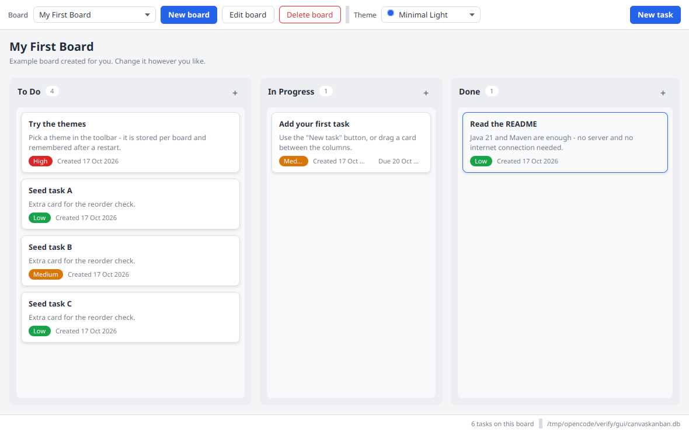
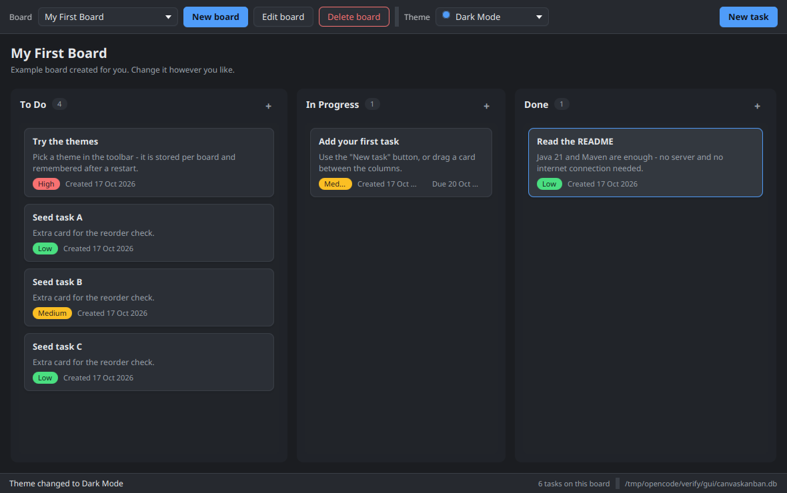
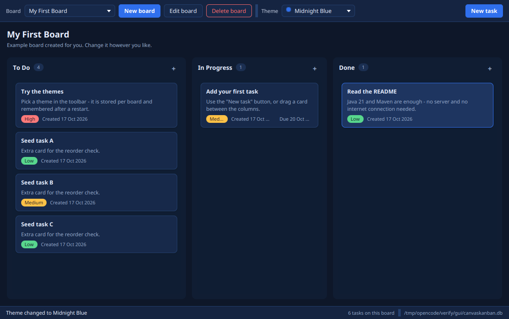
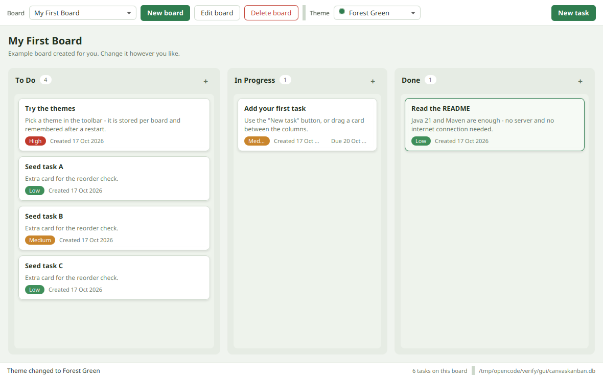
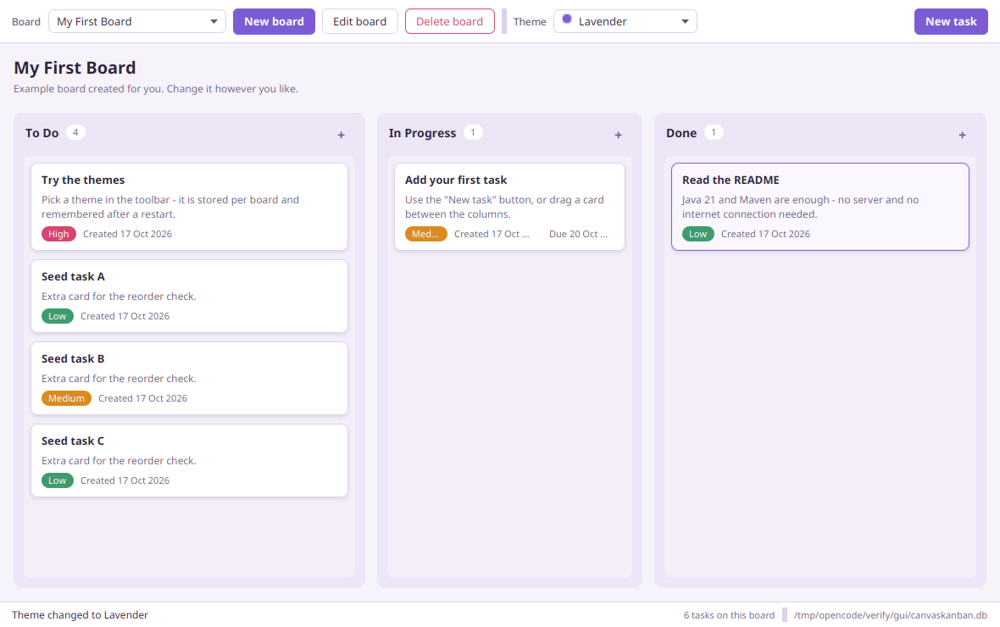
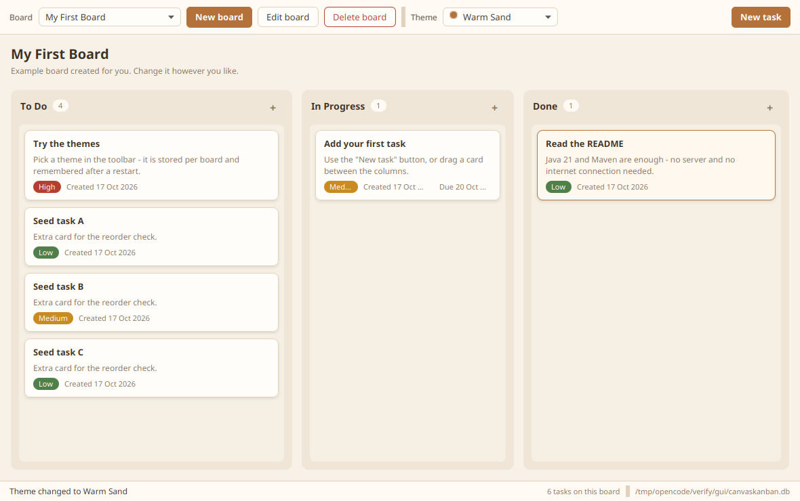

# CanvasKanban

A small, friendly desktop Kanban board, with everything stored locally in an
SQLite file.

**No account, no server, no internet connection - start it and start moving cards.**

## Download

No Java is needed: every package carries its own runtime, and neither the install
nor the uninstall ever touches your tasks.

### One command

| Platform | One command |
| --- | --- |
| **Linux** | `bash -c "$(curl -fsSL https://raw.githubusercontent.com/Param-42/canvaskanban/main/install.sh)"` |
| **Windows** | `powershell -NoProfile -ExecutionPolicy Bypass -Command "irm https://raw.githubusercontent.com/Param-42/canvaskanban/main/install.ps1 \| iex"` |

That is all: the app is installed into your home directory and appears in your menu
(plus a Desktop shortcut on Windows). Run the same command again later to update, or
`--uninstall` (`-Uninstall`) to remove it - your tasks are kept either way.

### Installers

Prefer a classic installer? These download the newest version directly:

| You are on | Download | Then |
| --- | --- | --- |
| Windows | [CanvasKanban-windows-x64.msi](https://github.com/Param-42/canvaskanban/releases/latest/download/CanvasKanban-windows-x64.msi) | double click it and follow the steps |
| Ubuntu / Debian | [canvaskanban-linux-x86_64.deb](https://github.com/Param-42/canvaskanban/releases/latest/download/canvaskanban-linux-x86_64.deb) | double click it, or `sudo apt install ./canvaskanban-linux-x86_64.deb` |
| Fedora / RHEL | [canvaskanban-linux-x86_64.rpm](https://github.com/Param-42/canvaskanban/releases/latest/download/canvaskanban-linux-x86_64.rpm) | `sudo dnf install ./canvaskanban-linux-x86_64.rpm` |
| any Linux, portable | [canvaskanban-linux-x86_64.tar.gz](https://github.com/Param-42/canvaskanban/releases/latest/download/canvaskanban-linux-x86_64.tar.gz) | unpack and run `CanvasKanban/bin/CanvasKanban` |
| Windows, portable | [CanvasKanban-windows-x64.zip](https://github.com/Param-42/canvaskanban/releases/latest/download/CanvasKanban-windows-x64.zip) | unpack and run `CanvasKanban.exe` |

Every link above points at `releases/latest`, so they keep working for future
versions. macOS is not packaged yet - build it from source, see
[docs/BUILDING.md](docs/BUILDING.md).

## Features

- **Boards** - create, rename and delete them. A fresh install starts with one
  example board.
- **Tasks** - title, description, priority (Low / Medium / High), optional due date.
- **Drag and drop** - drag a card into another column to change its status, or up
  and down to reorder it.
- **Six themes** - and each board can have its own.
- **Local storage** - an SQLite file in your user data folder, restored on the next
  start. No cloud, no telemetry, no network access at all.

## Themes

| | | |
| --- | --- | --- |
|  |  |  |
|  |  |  |

## Using the board

| What you want | What to do |
| --- | --- |
| Add a task | Click **New task**, or the **+** in a column header |
| Edit a task | Double click its card |
| Move a task | Drag the card into another column |
| Change the theme | Pick one in the **Theme** box |

Run it again any time to update; your data is never touched. Everything else about
using it - the full actions list, where the database lives, backup, troubleshooting -
is in [docs/USING.md](docs/USING.md).

## Documentation

- [**docs/USING.md**](docs/USING.md) - every action on the board, where your data lives,
  troubleshooting and known limitations
- [**docs/BUILDING.md**](docs/BUILDING.md) - build from source, run the tests, package
  installers, how continuous integration works
- [**docs/ARCHITECTURE.md**](docs/ARCHITECTURE.md) - the project structure and how the
  code fits together
